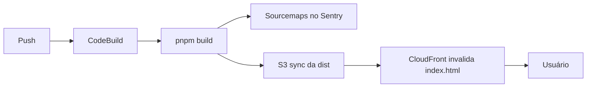

# React Production Ready


Starter React 19 + Vite + TypeScript pronto para produção, com shadcn/ui, Sentry, Microsoft Clarity e deploy na AWS (S3 + CloudFront).

## Stack

| Categoria     | Tecnologias                                     |
| ------------- | ----------------------------------------------- |
| Framework     | React 19, React Router                          |
| Build         | Vite, TypeScript                                |
| UI            | Tailwind CSS, shadcn/ui (Base UI)               |
| Monitoramento | Sentry (erros e source maps), Microsoft Clarity |
| Qualidade     | Biome, Husky, commitlint (gitmoji)              |
| CI e deploy   | GitHub Actions, AWS CodeBuild, S3, CloudFront   |

## Fluxo de deploy



## Deploy

O CI roda no GitHub Actions (`.github/workflows/ci.yml`) e o deploy no AWS CodeBuild (`buildspec.yml`), conforme o fluxo acima.

No projeto do CodeBuild, defina `S3_BUCKET` (nome do bucket) e `CLOUDFRONT_DISTRIBUTION_ID` (ID da distribuição), além das variáveis de ambiente descritas abaixo.

Para as rotas do React Router funcionarem, configure o CloudFront com `index.html` como default root object e mapeie os erros 403 e 404 para `/index.html` com status 200.

## Como rodar

```sh
pnpm install
pnpm dev
```

| Script         | Descrição                            |
| -------------- | ------------------------------------ |
| `pnpm dev`     | Inicia o servidor de desenvolvimento |
| `pnpm build`   | Checa os tipos e gera o build        |
| `pnpm preview` | Serve o build de produção            |

## Variáveis de ambiente

Crie um arquivo `.env`:

| Variável            | Uso                                 |
| ------------------- | ----------------------------------- |
| `VITE_SENTRY_DSN`   | DSN do Sentry                       |
| `VITE_CLARITY_ID`   | ID do projeto no Clarity            |
| `SENTRY_ORG`        | Upload de source maps (só no build) |
| `SENTRY_PROJECT`    | Upload de source maps (só no build) |
| `SENTRY_AUTH_TOKEN` | Upload de source maps (só no build) |

Sentry e Clarity só rodam no build de produção.
